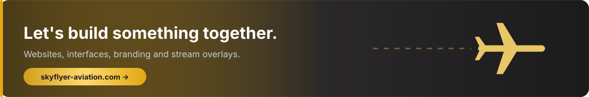

  

  <b>🟢 Open to front-end projects &amp; collaborations</b>

  
  
  

 

  

## The tools behind the work

<b>FRONT-END</b>

  

<b>DESIGN</b>

  

<b>WORKFLOW &amp; BACKEND</b>

  

  
  
  
  

## Featured work

<table>
  <tr>
    <td width="50%" valign="top">
      
      <h3><a href="https://github.com/upFrontEnd/skyflyer-aviation-website">Skyflyer Aviation</a></h3>
      
Showcase site for my flight-sim Twitch and YouTube channel. Live stream status, Zulu clock, projects and shop.

      
<code>Vue 3</code> <code>Vite</code> <code>SCSS</code> <code>Supabase</code>

      
<a href="https://www.skyflyer-aviation.com/"><b>Visit the site →</b></a>

    </td>
    <td width="50%" valign="top">
      
      <h3><a href="https://github.com/upFrontEnd/git-memento">Git Memento</a></h3>
      
Everyday Git commands sorted by topic, copied in one click. Light and dark themes.

      
<code>JavaScript</code> <code>HTML</code> <code>CSS</code>

      
<a href="https://git-memento.netlify.app/"><b>Try it live →</b></a>

    </td>
  </tr>
</table>

## Flight-sim stream toolkit

Everything on screen during my streams is built by hand: overlays for OBS, alerts, chat and a Twitch bot.

  

| Project | What it does | Stack |
| --- | --- | --- |
| [**stream-inflight-overlay**](https://github.com/upFrontEnd/stream-inflight-overlay) | Live flight bar for OBS (callsign, route, phase, aircraft). StreamFlight data coming next. | Vue 3 · Vite · SCSS |
| [**stream-inflight-command**](https://github.com/upFrontEnd/stream-inflight-command) | Twitch bot with flight commands (`!vol`, `!meteo`, `!eta`…) fed by the day's SimBrief flight plan. | JavaScript |
| [**stream-navi-overlay**](https://github.com/upFrontEnd/stream-navi-overlay) | Cockpit-style frame showing a Navigraph map and the current airline logo. | HTML · SCSS · JS |
| [**stream-alerts**](https://github.com/upFrontEnd/stream-alerts) | Twitch alerts overlay. | Bun · Vite · SCSS · JS |
| [**stream-chat**](https://github.com/upFrontEnd/stream-chat) | Custom chat widget for Streamlabs and OBS, with slide-in animations. | Bun · Vite · SCSS |

## Web experiments

| Project | Idea | Demo |
| --- | --- | --- |
| [**video-scroll**](https://github.com/upFrontEnd/video-scroll) | The mouse wheel scrubs through a video. | [Live](https://video-scrolling.netlify.app) |
| [**like-heart**](https://github.com/upFrontEnd/like-heart) | Animated "like" heart made with `steps()` and a sprite sheet. | [Live](https://step-like-heart.netlify.app) |
| [**sephora-memory-card-game**](https://github.com/upFrontEnd/sephora-memory-card-game) | Memory card game with perfume bottles. | [Live](https://sephora-memory-card-game.netlify.app/) |

 

  

