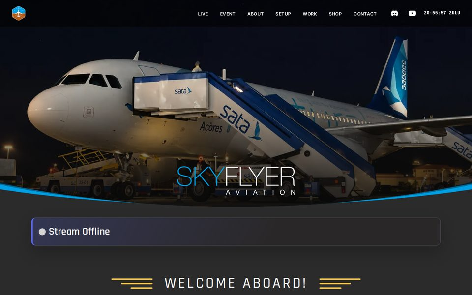
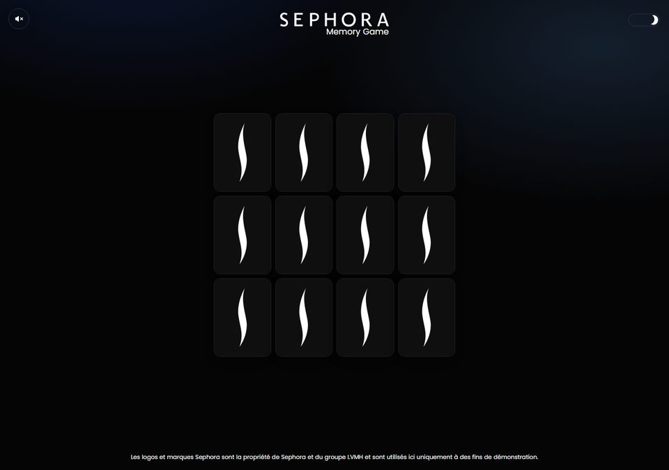
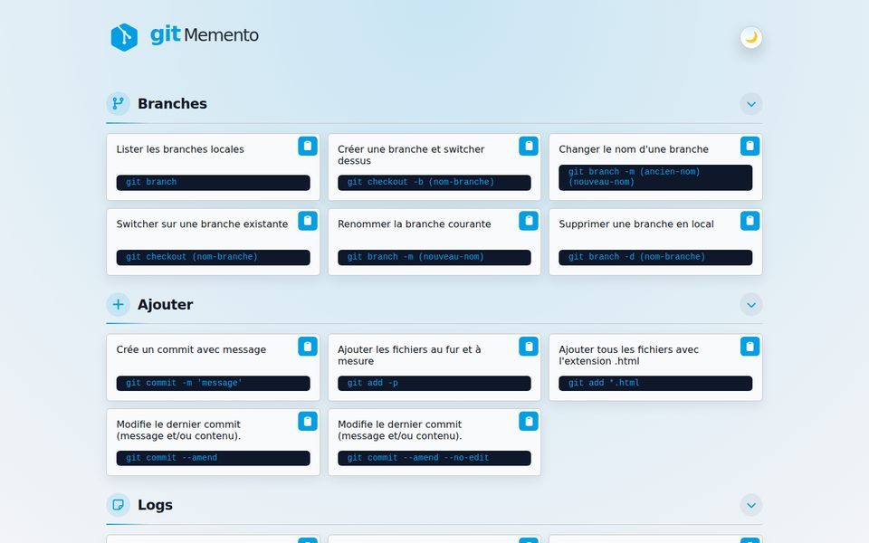
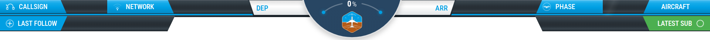

  

  <b>🟢 Open to front-end projects &amp; collaborations</b>

  

 

  

## The tools behind the work

<b>FRONT-END</b>

   

<b>DESIGN</b>

  

<b>WORKFLOW &amp; BACKEND</b>

  

## Featured projects

<table>
  <tr>
    <td width="50%" valign="middle">
      
    </td>
    <td width="50%" valign="middle">
      <h3>Skyflyer Aviation</h3>
      
The showcase site of my flight-sim Twitch and YouTube channel: live stream status, a Zulu clock, projects and a shop.

      
 

      

  
  

    </td>
  </tr>
</table>

<table>
  <tr>
    <td width="50%" valign="middle">
      <h3>Sephora Memory Game</h3>
      
A memory card game with a dark theme and a sound toggle, built as a clean, minimal front-end exercise.

      

      

  
  

    </td>
    <td width="50%" valign="middle">
      
    </td>
  </tr>
</table>

<table>
  <tr>
    <td width="50%" valign="middle">
      
    </td>
    <td width="50%" valign="middle">
      <h3>Git Memento</h3>
      
Everyday Git commands sorted by topic, each with a copy button, in light and dark themes.

      

      

  
  

    </td>
  </tr>
</table>

## Flight simulation stream toolkit

Everything on screen during my streams is built by hand: overlays for OBS, alerts, chat and a Twitch bot.

  

| Project | What it does | Stack | Repo |
| --- | --- | --- | :---: |
| **stream-inflight-overlay** | Live flight bar for OBS (callsign, route, phase, aircraft). |   |  |
| **stream-inflight-command** | Twitch bot with flight commands (`!vol`, `!meteo`, `!eta`…) fed by the day's SimBrief flight plan. |  |  |
| **stream-navi-overlay** | Cockpit-style frame showing a Navigraph map and the current airline logo. |   |  |
| **stream-alerts** | Twitch alerts overlay. |  |  |
| **stream-chat** | Custom chat widget for Streamlabs and OBS, with slide-in animations. |  |  |
